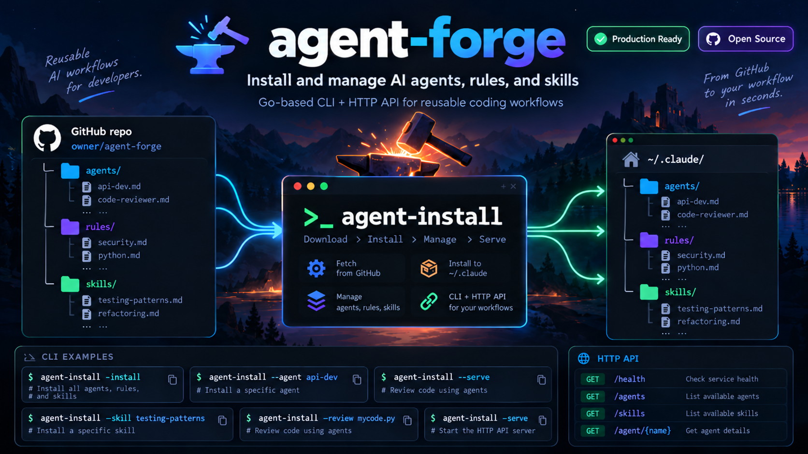

# Agent Installer

A lightweight Go-based CLI tool for installing and managing agents, skills, and rules from a centralised GitHub repository.



## Overview

The Agent Installer (`agent-install`) downloads AI agent configurations, skills, and workflow rules from GitHub and installs them to your local system. This enables:

- **Centralized Configuration Management** — Keep agents, skills, and rules in one GitHub repo
- **Version Control** — Download specific versions (tags) or the latest from main branch
- **Easy Updates** — Users get new configurations by running the installer
- **Offline Installation** — Download once, install anywhere
- **Dry-Run Testing** — Preview changes before applying them

## Quick Start

### Prerequisites

- Go 1.25+ (to build) or pre-compiled binary
- Internet access (to download from GitHub)
- ~50MB disk space for installations

### Installation

#### Option 1: Build from Source
```bash
git clone https://github.com/ic-consulting/agent-forge.git
cd agent-forge
go build -o bin/agent-install .
```

#### Option 2: Download Pre-built Binary

Download from [GitHub Releases](https://github.com/ic-consulting/agent-forge/releases):

**macOS:**
```bash
# Apple Silicon (ARM64)
curl -L https://github.com/ic-consulting/agent-forge/releases/latest/download/agent-install-macos-arm64 -o agent-install
chmod +x agent-install
./agent-install -help

# Intel (x86-64)
curl -L https://github.com/ic-consulting/agent-forge/releases/latest/download/agent-install-macos-amd64 -o agent-install
chmod +x agent-install
```

**Linux:**
```bash
# x86-64
curl -L https://github.com/ic-consulting/agent-forge/releases/latest/download/agent-install-linux-amd64 -o agent-install
chmod +x agent-install

# ARM64
curl -L https://github.com/ic-consulting/agent-forge/releases/latest/download/agent-install-linux-arm64 -o agent-install
chmod +x agent-install
```

**Windows:**
```powershell
# x86-64
Invoke-WebRequest https://github.com/ic-consulting/agent-forge/releases/latest/download/agent-install-windows-amd64.exe -OutFile agent-install.exe

# ARM64 (Snapdragon / Copilot+ PCs)
Invoke-WebRequest https://github.com/ic-consulting/agent-forge/releases/latest/download/agent-install-windows-arm64.exe -OutFile agent-install.exe

.\agent-install.exe -help
```

Each release includes a `SHA256SUMS` file for verifying downloads.

Or visit [Releases Page](https://github.com/ic-consulting/agent-forge/releases) to download directly.

### Basic Usage

#### List available files
```bash
./bin/agent-install -contents
```

#### Preview installation (dry-run)
```bash
./bin/agent-install -dryrun
```

#### Install to default location (~/.claude)
```bash
./bin/agent-install -install
```

#### Install to custom location
```bash
./bin/agent-install -install -target ~/my-claude-config

# Pass the same -target to read from it
./bin/agent-install -agent api-dev -target ~/my-claude-config
```

The agent files tell Claude to read their rules from `~/.claude/rules/`, so
agents installed elsewhere won't find their rules unless you also install
to `~/.claude`.

#### Install specific version
```bash
./bin/agent-install -install -version v1.0.0
```

## Available Agents

The installer includes agents for:

- **API Development** (`api-dev`, `api-reviewer`)
- **Database Work** (`database-dev`, `db-reviewer`)
- **Frontend Development** (`frontend-dev`, `frontend-reviewer`)
- **Backend Languages** (`go-dev`, `python-dev`, `node-dev`, `rust-dev`)
- **Python Frameworks** (`fastapi-dev`, `django-dev`)
- **Code Review** (`code-reviewer`, `security-reviewer`)
- **DevOps** (`devops-dev`)
- **Testing** (`test-writer`)
- **Design** (`ui-designer`)
- **Task Planning** (`task-planner`)
- **Debugging** (`debugger`)
- **Business Challenge** (`critical-friend`)

### Choosing a challenge agent

- **`critical-friend`**: Tests a business idea or concept. It surfaces assumptions, objections, and kill criteria, and it gives a verdict. It is non-technical and read-only. Technical questions belong to the ARB panel (`arb-panel`).
- **Architecture Review** (`arb-panel`)

### Choosing a review agent

- **`code-reviewer`**: Code-level review of a change, using the team's standards.
- **`arb-panel`**: Architecture review of a proposal, design, or ADR. It convenes five personas (business person, lead architect, chief engineer, lead CISO, and programme management lead) and returns a consolidated decision with conditions. The lead CISO can block approval.

### Choosing a Python agent

- **`fastapi-dev`**: FastAPI implementation, including routers, Pydantic schemas, dependencies, async services, persistence integration, and tests.
- **`django-dev`**: Django implementation, including views, forms, templates, models, migrations, admin, and DRF APIs when the project already uses DRF.
- **`python-dev`**: General Python backend work and Flask services.
- **`api-dev`**: Framework-neutral API contracts and design; use the framework agent for deeper implementation.

Both framework agents reuse the shared Python rules and, for API work, the API rules. They inspect the project's installed versions and conventions rather than imposing a new stack. Use `python-reviewer` and, for API changes, `api-reviewer` for independent review.

## Skills and Rules

### Skills
- **Security Assessment** — Comprehensive security audit workflows
- **ARB Review** — Per-persona checklists and severity rules for architecture reviews (used by `arb-panel`)

### Rules
Development workflow rules for:
- API Development (`api-dev`)
- Frontend Development (`frontend-dev`)
- Go Development (`go-dev`)
- Node.js Development (`nodejs-dev`)
- Python Development (`python-dev`)
- Rust Development (`rust-dev`)
- SQL/Database (`sql-dev`)
- Git Workflow (`git-workflow`)

## Command Reference

### Actions (pick one)

| Flag | Description |
|------|-------------|
| `-contents` | List all available files without installing |
| `-dryrun` | Show installation plan without writing files |
| `-install` | Perform actual installation |

### Options

| Flag | Default | Description |
|------|---------|-------------|
| `-repo` | `ic-consulting/agent-forge` | GitHub repository (owner/repo format) |
| `-version` | `main` | Version tag (e.g., `v1.0.0`) or branch name |
| `-target` | `~/.claude` | Directory to install into, and to read from for `-agent`, `-skill`, `-review` and `-serve` |

### Examples

```bash
# List all files from main branch
agent-install -contents

# List files from specific version
agent-install -contents -version v1.0.0

# Preview installation from v1.2.3
agent-install -dryrun -version v1.2.3

# Install latest to custom location
agent-install -install -target ~/.claude-prod

# Install from different repo
agent-install -install -repo username/custom-agents
```

## Installation Directory Structure

After installation, your directory will look like:

```
~/.claude/
├── agents/
│   ├── api-dev.md
│   ├── api-reviewer.md
│   ├── code-reviewer.md
│   ├── database-dev.md
│   ├── debugger.md
│   ├── devops-dev.md
│   ├── django-dev.md
│   ├── fastapi-dev.md
│   ├── frontend-dev.md
│   ├── frontend-reviewer.md
│   ├── go-dev.md
│   ├── node-dev.md
│   ├── python-dev.md
│   ├── rust-dev.md
│   ├── security-reviewer.md
│   ├── task-planner.md
│   ├── test-writer.md
│   └── ui-designer.md
├── rules/
│   ├── api-dev.md
│   ├── frontend-dev.md
│   ├── git-workflow.md
│   ├── go-dev.md
│   ├── nodejs-dev.md
│   ├── python-dev.md
│   ├── rust-dev.md
│   └── sql-dev.md
└── skills/
    └── security-assessment/
        ├── SKILL.md
        ├── checklist.md
        └── scripts/
            └── scan-secrets.py
```

## Version Management

### How Versions Work

- **Branch names** (e.g., `-version main`, `-version develop`) — Downloads latest from that branch
- **Tag names** (e.g., `-version v1.0.0`, `-version v1.2.3`) — Downloads specific tagged release

### Smart Detection

The installer automatically detects version type:
- Versions starting with `v` followed by a digit (e.g., `v1.0.0`) are treated as tags
- All other values (e.g., `main`, `develop`, `feature/x`) are treated as branch names

### Available Versions

```bash
# List remote tags
git ls-remote --tags https://github.com/ic-consulting/agent-forge.git | grep "refs/tags"

# Current releases
- v1.0.0 — Initial stable release (agents, skills, rules)
- main   — Latest development version
```

## Installation Behavior

The installer is smart about file handling:

| Status | Behavior |
|--------|----------|
| **NEW** | File doesn't exist locally → Created |
| **SAME** | File exists and content matches → Skipped |
| **OVERWRITE** | File exists but content differs → Backed up as `.bak`, then overwritten |

Example output:
```
NEW       agents/go-dev.md -> ~/.claude/agents/go-dev.md
SAME      agents/api-dev.md -> ~/.claude/agents/api-dev.md
OVERWRITE agents/python-dev.md -> ~/.claude/agents/python-dev.md
           (backed up as python-dev.md.bak)

installed into ~/.claude: 2 new, 1 overwritten, 1 unchanged
```

## Using Installed Agents and Rules

Once installed, refer to the files in your IDE or Claude:

1. **In VS Code**: Open `.claude/agents/go-dev.md` as a custom instruction
2. **In Claude Web**: Copy content from `.claude/agents/` and `.claude/rules/` into system prompts
3. **In Claude API**: Load files programmatically and include in system messages

Example:
```bash
# Get agent content
cat ~/.claude/agents/api-dev.md

# Use as the system prompt in an API request. jq builds the JSON body, so
# quotes and newlines in the agent file are escaped correctly.
jq -n --rawfile system ~/.claude/agents/go-dev.md '{
  model: "claude-opus-5-5",
  max_tokens: 16000,
  system: $system,
  messages: [{role: "user", content: "Build me a REST API"}]
}' | curl https://api.anthropic.com/v1/messages \
  -H "x-api-key: $ANTHROPIC_API_KEY" \
  -H "anthropic-version: 2023-06-01" \
  -H "content-type: application/json" \
  -d @-
```

## Configuration Management

### Custom Repositories

To use a custom repository instead of the default:

```bash
# One-time use
./bin/agent-install -install -repo username/my-agents -version main

# Or create an alias
alias install-my-agents='./bin/agent-install -install -repo username/my-agents'
install-my-agents
```

### Repository Requirements

Your custom repository should follow this structure:

```
your-repo/
└── configs/
    ├── agents/
    │   ├── agent1.md
    │   ├── agent2.md
    │   └── ...
    ├── skills/
    │   ├── skill1/
    │   │   ├── SKILL.md
    │   │   └── ...
    │   └── ...
    └── rules/
        ├── rule1.md
        ├── rule2.md
        └── ...
```

## Troubleshooting

### "no config files found in archive"
- Ensure the repository has the correct structure (`configs/agents/`, `configs/skills/`, `configs/rules/`)
- Check that the branch or tag exists: `git ls-remote origin`

### "HTTP 404" error
- Verify the repository name is correct: `-repo owner/repo`
- Confirm the version/tag exists on GitHub
- Check internet connectivity

### Files already exist (OVERWRITE)
- The installer automatically backs up old files as `.bak`
- Review changes: `diff file.md file.md.bak`
- Restore if needed: `mv file.md.bak file.md`

### Permission denied
- Ensure target directory is writable: `chmod u+w ~/.claude`
- Try with different `-target` location
- Check disk space: `df -h`

## Contributing

### Adding New Agents/Skills/Rules

1. Fork or create a branch in the config repository
2. Add files to `configs/agents/`, `configs/skills/`, or `configs/rules/`
3. Commit and push: `git push origin feature/new-agent`
4. Create a pull request
5. Once merged, a maintainer pushes a release tag: `git tag -a v1.1.0 -m "Added new agent" && git push origin v1.1.0`. CI builds and publishes the binaries (see [Releases](#releases)).
6. Users can then install: `agent-install -install -version v1.1.0`

### Repository: ic-consulting/agent-forge
- **Main**: Development/latest version
- **v1.0.0+**: Stable releases
- Configuration files in `configs/` subdirectory

## Development

### Building the Installer

```bash
# Clone this repository
git clone https://github.com/ic-consulting/agent-forge.git
cd agent-forge

# Build
go build -o bin/agent-install .

# Test
./bin/agent-install -dryrun
./bin/agent-install -contents -version v1.0.0
```

### Cross-compiling

`build.sh` builds every supported platform into `bin/`, plus a `SHA256SUMS` file:

| OS | amd64 | arm64 |
|---|---|---|
| macOS | `agent-install-macos-amd64` | `agent-install-macos-arm64` |
| Linux | `agent-install-linux-amd64` | `agent-install-linux-arm64` |
| Windows | `agent-install-windows-amd64.exe` | `agent-install-windows-arm64.exe` |

```bash
./build.sh
```

On Windows, run it from Git Bash or WSL.

### Releases

The [Build workflow](.github/workflows/build.yml) runs `go vet` and `build.sh` on every pull request and push to `main`. Pushing a `v*` tag also publishes the binaries to a GitHub release:

```bash
git tag -a v1.1.0 -m "Added new agent"
git push origin v1.1.0
```

If a release for the tag already exists (for example, one drafted by hand with notes), the workflow attaches the binaries to it. Otherwise it creates the release with generated notes.

### Project Structure

```
agent-forge/
├── main.go              # CLI entry point, GitHub download logic
├── go.mod              # Go module definition
├── build.sh            # Cross-compiles all platforms
├── .github/workflows/  # CI build and release
├── bin/
│   └── agent-install  # Compiled binary
└── README.md           # This file
```

### Key Functions

- `main()` — CLI argument parsing
- `downloadConfig()` — Fetches zip from GitHub, extracts files to memory
- `collect()` — Lists files from in-memory storage
- `plan()` — Determines installation actions (NEW/OVERWRITE/SAME)
- `runInstall()` — Writes files to disk with backups

## Performance

- **Download size**: ~500KB (compressed zip)
- **Extraction**: ~1 second
- **Installation**: ~100ms for typical config set
- **Disk space**: ~50KB for all agents + skills + rules

## Integration 

https://github.com/ic-consulting/agent-forge/blob/f2d7f0b587965b6046fe9f0739adbff6f7411f0e/INTEGRATION_GUIDE.md

## License

MIT License — See LICENSE file in repository

## Support & Feedback

- **Issues**: [GitHub Issues](https://github.com/ic-consulting/agent-forge/issues)
- **Discussions**: [GitHub Discussions](https://github.com/ic-consulting/agent-forge/discussions)
- **Config Repository**: [github.com/ic-consulting/agent-forge](https://github.com/ic-consulting/agent-forge)

---

**Latest Version**: v1.0.1  
**Last Updated**: October 19, 2026
