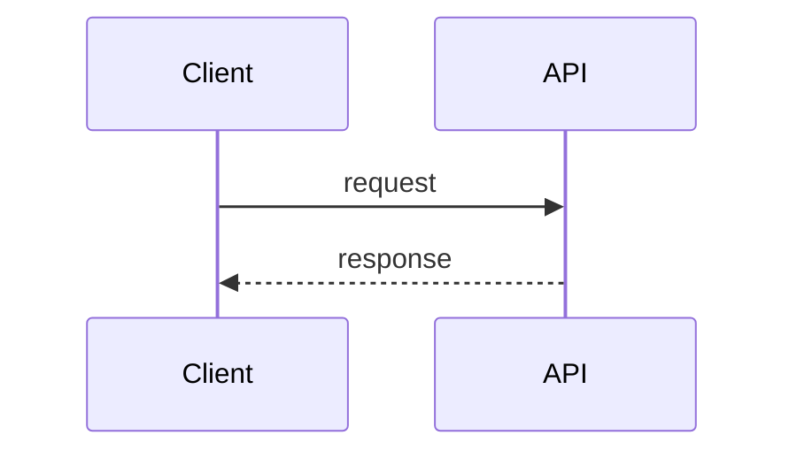

---
paths:
  - "docs/backlog/**"
---

# Product Planning Rules

Applies to the planning agents (`epic-writer`, `user-story-writer`, `task-writer`, `sequence-diagram-writer`) and to any backlog file under `docs/backlog/`.

## Output layout
- Epics: `docs/backlog/epics/EPIC-001-short-slug.md`
- Stories: `docs/backlog/stories/US-001-short-slug.md`
- Tasks: `docs/backlog/tasks/TASK-001-short-slug.md`
- Diagrams: `docs/backlog/diagrams/US-001-short-slug.mmd.md` (one diagram per file, named after the story it illustrates)
- One artifact per file. Each file must make sense on its own.
- Numbers are sequential within a type and never reused. If a file is removed, its number stays retired.

## IDs and cross-references
- Format: `EPIC-NNN`, `US-NNN`, `TASK-NNN`. Three digits, zero-padded.
- Every story lists its parent epic. Every task lists its parent story. Every diagram lists the story it illustrates.
- Reference other items by ID, not by title, so renames don't break links.
- Dependencies are listed by ID under a `Depends on` field. Don't describe them only in prose.

## Writing style
- Describe outcomes and behaviour, not implementation, unless the artifact is a task.
- One sentence per acceptance criterion, in Given/When/Then form.
- No undefined terms. If a term needs a definition, add it to the epic's glossary section.
- Don't invent metrics, numbers, or customer names. If a value is unknown, write `TBD` and list it under Open questions.
- Say what is out of scope. An epic or story with no out-of-scope section is incomplete.

## Definition of ready (story)
A story is ready for development when all of these are true:
- It has a parent epic ID.
- It follows the "As a / I want / so that" form, with a named role that is not "user" alone when a more specific role exists.
- It has at least one acceptance criterion, and each criterion is testable.
- It passes INVEST: Independent, Negotiable, Valuable, Estimable, Small, Testable. Any failed check is noted in the story, not silently ignored.
- It has a size estimate in story points (Fibonacci: 1, 2, 3, 5, 8). Anything over 8 must be split.
- Open questions are either resolved or explicitly listed.

## Definition of done (task)
A task is done when:
- Its done condition is written as a verifiable statement, for example "`GET /orders` returns paginated results with a `next_cursor` field and a test covers the empty case".
- It names the likely files, packages, or modules it touches, or states that they are unknown.
- It names a suggested implementer agent from `configs/agents/` (for example `go-dev`, `frontend-dev`, `database-dev`), or says none fits.

## Sequence diagrams
- Use Mermaid `sequenceDiagram` syntax inside a fenced `mermaid` block.
- Show the happy path first, then error paths with `alt` or `opt` blocks.
- Participant names should match real components in the code when a codebase is present. Verify with Grep before using a name. If no code exists yet, mark the names as proposed.
- Keep one flow per diagram. If a story covers two flows, write two diagrams.

## Templates

### Epic
```markdown
# EPIC-NNN: Title

**Status:** Draft | Ready | In progress | Done
**Owner:** TBD

## Goal
One paragraph: the outcome this epic delivers and who benefits.

## Scope
- Included behaviour, as a list of outcomes

## Out of scope
- Explicitly excluded behaviour

## Success metrics
- Measurable outcome, or `TBD`

## Dependencies
- EPIC-NNN / external system / decision

## Stories
- US-NNN: title

## Glossary
- Term: definition (omit section if none)

## Open questions
- Question
```

### User story
```markdown
# US-NNN: Title

**Epic:** EPIC-NNN
**Status:** Draft | Ready | In progress | Done
**Size:** 1 | 2 | 3 | 5 | 8
**Depends on:** US-NNN, ... (or None)

## Story
As a <role>, I want <capability>, so that <benefit>.

## Acceptance criteria
1. Given <context>, when <action>, then <result>.

## INVEST check
- Independent: yes | no, reason
- Negotiable: yes | no, reason
- Valuable: yes | no, reason
- Estimable: yes | no, reason
- Small: yes | no, reason
- Testable: yes | no, reason

## Notes
Constraints, links to diagrams, or context that doesn't fit above.

## Open questions
- Question
```

### Task
```markdown
# TASK-NNN: Title

**Story:** US-NNN
**Status:** To do | In progress | Done
**Suggested agent:** go-dev | frontend-dev | database-dev | ... | none
**Depends on:** TASK-NNN, ... (or None)

## Description
What needs to change and why, in two to four sentences.

## Likely touch points
- Files, packages, or modules, or `Unknown until investigated`

## Done when
- Verifiable statement

## Notes
```

### Sequence diagram
````markdown
# Sequence: Title

**Illustrates:** US-NNN



## Notes
Assumptions, proposed participant names, and error paths not shown.
````

## Review
- Every planning artifact is reviewed by a human before its status moves from Draft to Ready.
- Agents set status to Draft. They never set a story or epic to Ready or Done.
